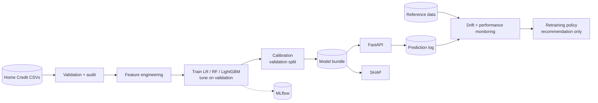

# Credit Risk Decision Engine

An end-to-end credit default prediction, risk assessment and model-monitoring project built on the public *Home Credit Default Risk* dataset.

> **Educational portfolio project.** Not a lending system and not validated for real credit decisions. It uses public competition data and makes no claim about production adoption or business impact.

## 1. Overview
The pipeline validates and audits the data, engineers credit-risk features, trains logistic regression / random forest / LightGBM with a leakage-safe protocol, calibrates probabilities, converts probabilities into illustrative risk categories and policy scenarios, explains predictions with SHAP, serves the model through a FastAPI service, tracks experiments in MLflow and monitors drift.

## 2. Business problem
A fintech wants to estimate the probability that an applicant will have payment difficulties and use it for decision support (risk bands, review routing, threshold trade-offs).

## 3. Why credit risk prediction matters
Lending losses, fair access to credit and capital requirements all depend on how well risk is ranked *and* how reliable the probabilities are. This makes ranking quality (ROC-AUC, KS), probability quality (Brier, calibration), explainability and monitoring first-class concerns here, rather than accuracy alone.

## 4. Dataset
Kaggle *Home Credit Default Risk* - <https://www.kaggle.com/competitions/home-credit-default-risk/data>. Required: `application_train.csv`. Optional: `bureau.csv`, `previous_application.csv` (aggregated with `--supplementary`). **The data is never committed or downloaded automatically.** Download it manually (instructions in [`data/README.md`](data/README.md)) into `data/raw/`; the project prints a per-file status report and clear instructions if files are missing.

## 5. Architecture

Details: [`docs/architecture.md`](docs/architecture.md), [`docs/methodology.md`](docs/methodology.md), [`docs/api_reference.md`](docs/api_reference.md).

## 6. Technology stack
Python 3.11+, pandas, NumPy, scikit-learn, LightGBM, SHAP, MLflow, FastAPI/Pydantic/Uvicorn, pytest, Docker/Docker Compose, matplotlib/seaborn. Monitoring is a lightweight custom implementation (PSI, KS, missingness, prediction drift), chosen over adding Evidently to keep dependencies small.

## 7. Installation
```bash
git clone <your-fork-url> && cd credit-risk-decision-engine
python -m venv .venv && source .venv/bin/activate     # Windows: .venv\Scripts\activate
pip install -r requirements.txt                        # or: pip install -e ".[dev]"
```

## 8. Data preparation
```bash
# place application_train.csv in data/raw/, then:
python scripts/run_eda.py            # status report, validation, audit, figures in reports/figures/
```
No dataset yet? Exercise the code with **synthetic** data (not real results): add `--demo` to any script, or `python scripts/generate_demo_data.py`.

## 9. Training
```bash
python scripts/train.py --lightweight     # 40k-row stratified subsample, fewer trials (8 GB machines)
python scripts/train.py                   # full dataset
python scripts/train.py --supplementary   # + bureau / previous_application aggregates if present
python scripts/train.py --no-mlflow --no-shap
```
Outputs: `artifacts/model_bundle.joblib`, `metrics.json`, `model_comparison.csv`, `policy_comparison.csv`, `threshold_sensitivity.csv`, `risk_tiers.csv`, monitoring references, figures in `reports/figures/`, and an auto-generated `reports/experiment_report.md`.

## 10. Evaluation
`python scripts/evaluate.py` re-scores the deterministic test split from raw data with the saved bundle (verifies train/inference consistency). Protocol: stratified 60/20/20 split; tuning, calibration choice, thresholds and model selection on validation only; one final test evaluation. Metrics: ROC-AUC, PR-AUC, KS, Brier, log-loss, precision/recall/F1, confusion matrix, calibration curve. Accuracy is deliberately not used for selection because of class imbalance.

## 11. Explainability
Global SHAP importance, beeswarm summary and dependence plots are produced at training time (`reports/figures/shap_*`); local explanations are available through `ModelBundle.explain`, `credit_risk.explainability.explain_instance` and `POST /predict?explain=true`. SHAP describes model behaviour, not causality.

## 12. API usage
```bash
export CREDIT_RISK_MODEL_PATH=artifacts/model_bundle.joblib
uvicorn credit_risk.api.main:app --port 8000          # Swagger UI: http://localhost:8000/docs
curl -s localhost:8000/health
curl -s -X POST "localhost:8000/predict?explain=true" -H 'content-type: application/json' \
  -d '{"AMT_INCOME_TOTAL":150000,"AMT_CREDIT":450000,"AMT_ANNUITY":18000,"EXT_SOURCE_2":0.6,"EXT_SOURCE_3":0.4}'
```
Endpoints: `GET /health`, `GET /model-info`, `POST /predict`, `POST /predict/batch`. See [`docs/api_reference.md`](docs/api_reference.md).

## 13. Docker deployment
```bash
docker compose up --build                            # inference API on :8000 (needs artifacts/model_bundle.joblib)
docker compose --profile train run --rm trainer      # one-off training job (reads ./data/raw)
docker compose --profile tracking up -d mlflow       # MLflow UI on :5000
```
MLflow without Docker: `mlflow ui --backend-store-uri sqlite:///mlflow.db --port 5000`. Training, inference and tracking are separate services; no cloud credentials are needed. See "Verification status" below.

## 14. Monitoring
`python scripts/monitor_demo.py` runs a **simulated** shift (higher incomes/loan amounts, more missing `EXT_SOURCE_1`) at two severities and writes `reports/monitoring_demo_report.md`: feature drift (PSI, KS, missing-rate change), prediction drift, performance on labelled outcomes and the retraining-policy recommendation. Concepts (data drift vs concept drift vs prediction drift vs performance degradation) and the trigger policy are documented in [`docs/methodology.md`](docs/methodology.md#10-monitoring). Drift alone never triggers retraining.

## 15. Results
**Not yet generated from real data.** The Home Credit files were not available when this repository was built, so no real-data metrics are reported and none should be inferred. To populate this section:

```bash
python scripts/train.py && cat reports/experiment_report.md
```
| Model | Val ROC-AUC | Test ROC-AUC | Test PR-AUC | Test KS | Brier (cal.) |
|---|---|---|---|---|---|
| Logistic regression | _run training_ | | | | |
| Random forest | _run training_ | | | | |
| LightGBM | _run training_ | | | | |

## 16. Limitations
Single historical dataset without timestamps (random, not out-of-time split); approved-loans-only selection bias; sensitive attributes excluded but proxies remain and no fairness metrics are computed; illustrative risk bands and costs; the API accepts a subset of the raw columns; no authentication or model registry. Full list: [`reports/limitations.md`](reports/limitations.md).

## 17. Future improvements
Out-of-time validation if timestamps are available; fuller use of the six supplementary tables; reject inference; group-wise fairness evaluation; confidence intervals via repeated splits; MLflow Model Registry stages; Evidently dashboards; authentication/rate limiting; CI pipeline (lint, tests, image build).

## Testing
```bash
pytest -q                          # unit, API and monitoring tests (synthetic fixtures; no dataset needed)
ruff check src tests scripts
```
Tests use **synthetic** data and verify behaviour (validation, preprocessing consistency, probability range, API contracts, drift logic), not real-world accuracy.

## Verification status
| Item | Status |
|---|---|
| Unit/API/monitoring tests (`pytest`) | executed in the development environment, all passing |
| Lint (`ruff`) | executed, clean |
| End-to-end run (EDA -> train -> MLflow -> evaluate -> monitor demo -> live API with curl) | executed on **synthetic** data only |
| Notebooks | executed without errors on synthetic data; outputs cleared |
| Training on real Home Credit data | **not run** (dataset unavailable offline) |
| Docker image / Compose stack | written, YAML parsed; **not built or run** (no Docker daemon available) |

## Repository layout
```
configs/   config.yaml, model_config.yaml     src/credit_risk/   data, features, models, decision, explainability, api, monitoring
scripts/   train, evaluate, run_eda, monitor_demo, generate_demo_data      tests/   pytest suite
notebooks/ 01..05 analysis notebooks          reports/ model card, business memo, limitations, experiment report
docs/      architecture, methodology, API reference, publishing checklist
```

## What I Learned
> Written from the engineering of this project; replace with your own reflections after running it on the real data.

- **Smoke-testing the served model caught what unit tests did not.** Scaled missing-value flags for almost-never-missing columns pushed partial API requests to extreme probabilities, and omitted categorical fields became out-of-vocabulary one-hot vectors. The fixes (indicators only where training missingness >= 1%, unscaled; mode imputation unless "missing" is a real training category) came with regression tests.
- **Calibration is a separate step from ranking.** Class weighting can improve ranking while badly distorting probabilities; fitting the calibrator on held-out validation predictions and choosing the method by cross-validated Brier keeps the test set clean.
- **Leakage hides in preprocessing.** Target encoding must be cross-fitted, scalers/winsorisation bounds learned on the training split only, and the whole chain serialised so inference matches training.
- **Dropping sensitive columns is not a fairness solution.** Proxies remain and fairness needs measurement and policy, not just exclusion; this project documents that gap but does not close it.
- **Drift is not degradation.** Drift statistics are cheap but ambiguous; the policy therefore escalates drift to investigation and reserves retraining recommendations for labelled evidence.
- **Unresolved:** random rather than out-of-time evaluation, selection bias from approved-only data, and Docker/real-data runs still to be verified by the repository owner.

## License
MIT (see `LICENSE`). Dataset terms are governed by the Kaggle competition rules.
