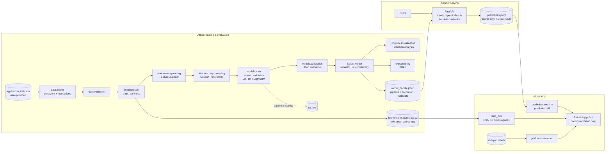
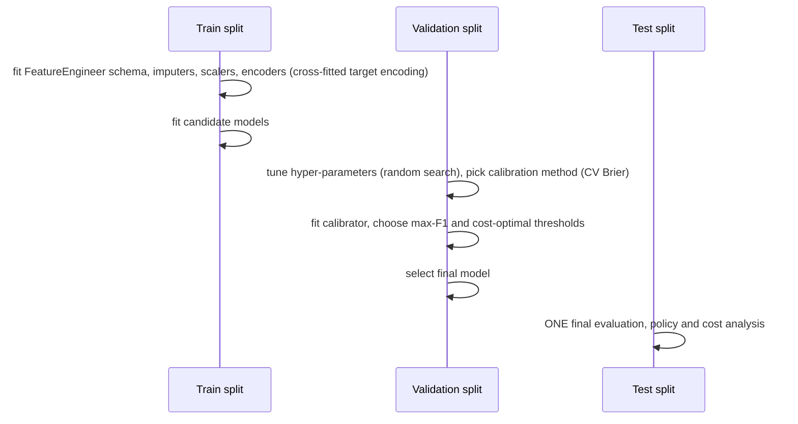

# Architecture

## Components

## Training sequence and leakage controls

## Module map

| Package | Responsibility |
|---|---|
| `credit_risk.config` | YAML configuration, env overrides, lightweight mode |
| `credit_risk.data` | `loader` (discovery, manual-download instructions), `validation`, `audit`, `synthetic` (tests/demo only) |
| `credit_risk.features` | `engineering.FeatureEngineer` (serialised in the pipeline), `preprocessing` (column groups, ColumnTransformer, split) |
| `credit_risk.models` | `baseline` (factories), `train`, `evaluate`, `calibration`, `predict.ModelBundle` |
| `credit_risk.decision` | risk bands, threshold sweep, expected-cost, policy comparison |
| `credit_risk.explainability` | SHAP global/local explanations |
| `credit_risk.api` | FastAPI app, schemas, model loading |
| `credit_risk.monitoring` | drift statistics, prediction logging, retraining policy |

## Design decisions

- **One artifact for inference.** `ModelBundle` serialises feature engineering + preprocessing + model + calibrator + schema, so API and offline evaluation share a single code path. `scripts/evaluate.py` reproduces training-time test metrics from raw data to confirm this.
- **Config-driven.** Paths, split, tuning budget, risk bands, policies, costs and monitoring thresholds live in `configs/`.
- **Local-first deployment.** Docker Compose separates inference (`api`), a one-off `trainer` job and `mlflow`; no cloud credentials.
- **No raw applicant data in logs.** The prediction log stores score, category, model version and the *names* of missing core fields only.
